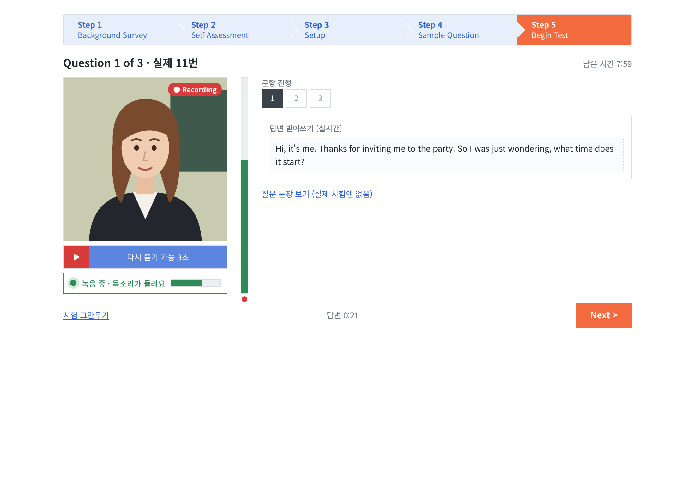
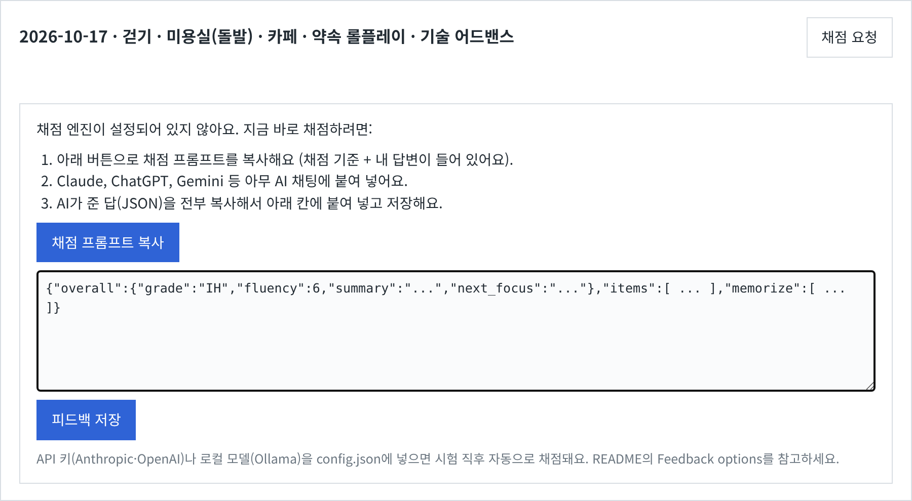
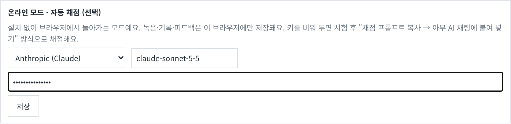
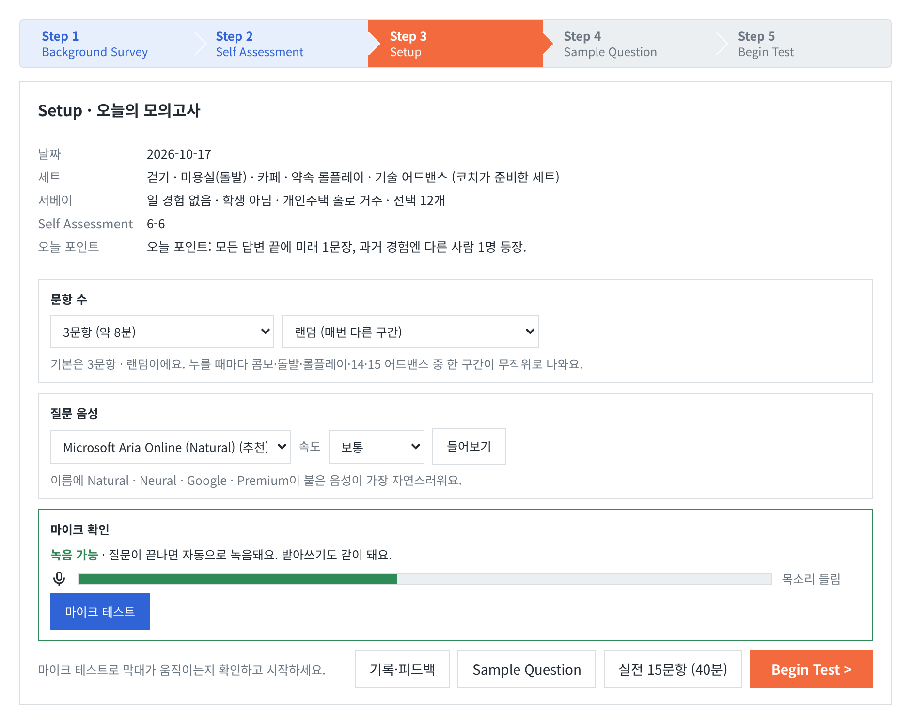
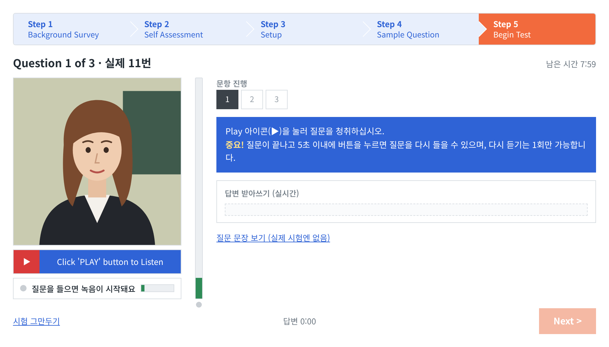
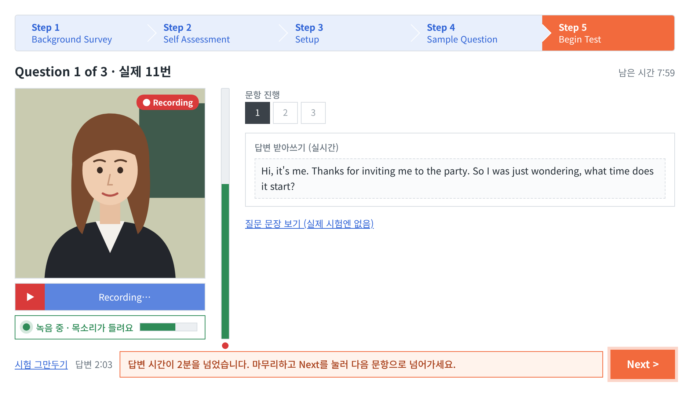
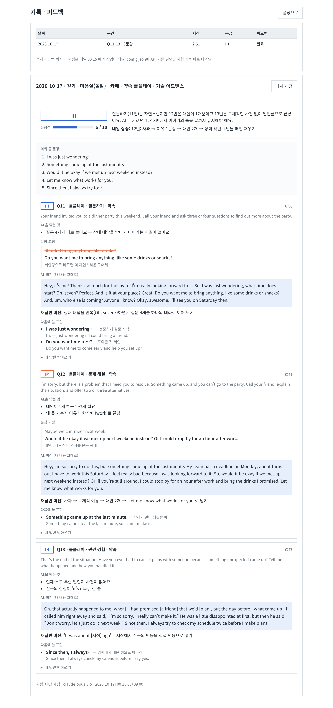
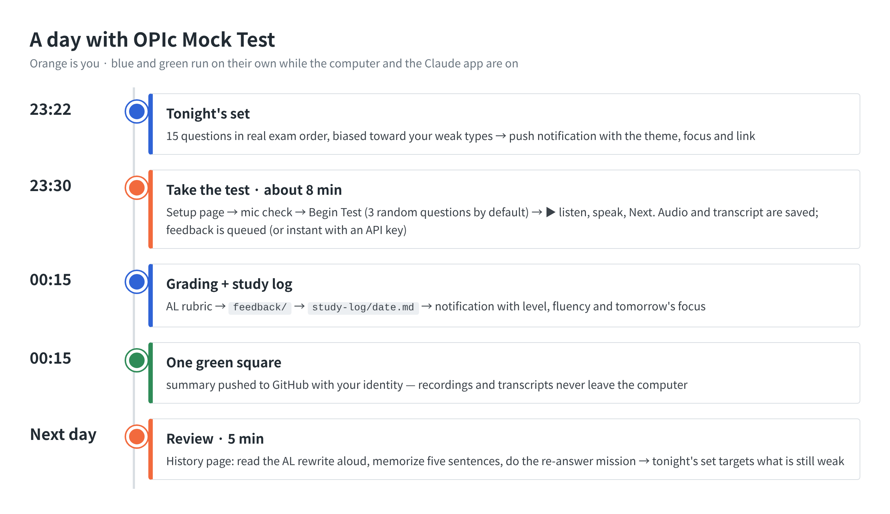
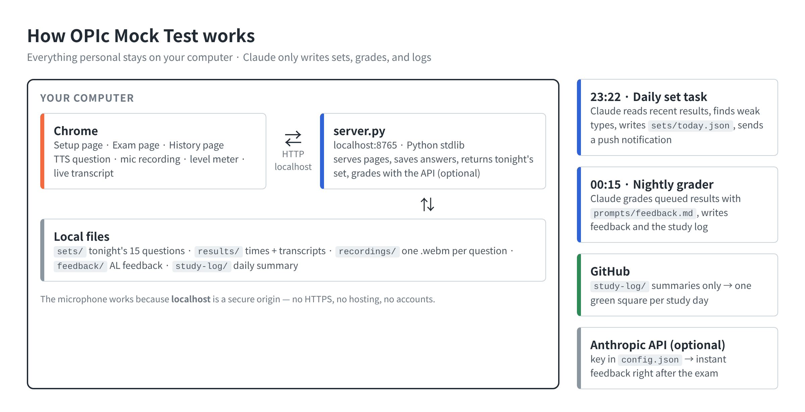

# OPIc Mock Test

> **About** — An OPIc speaking mock test that looks and runs like the real exam
> screen: automatic recording with a live transcript, a question set built in the
> real exam order, feedback aimed at the Advanced Low (AL) level, and an optional
> nightly routine that fills your GitHub contribution graph.

## ▶ Try it now — no install

**https://leesk212.github.io/OPIC-Mock-Test/**

Open it in **Chrome**, allow the microphone, press **Begin Test**. That's it.
Recordings, transcripts and feedback stay in your browser.



---

## Quick start

There are two ways to run it. Both give you the same exam screen.

| | **Online** (GitHub Pages) | **Local** (`server.py` on your computer) |
|---|---|---|
| Setup | none — open the link | `git clone` + `python3 server.py` |
| Recordings & results | your browser (localStorage / IndexedDB) | files on disk (`recordings/`, `results/`) |
| Question set | built-in bank, new every day | built-in bank, or a set you (or a scheduled task) drop into `sets/` |
| Feedback | copy-paste, or your own API key saved in the browser | copy-paste, API key or local model in `config.json` |
| Nightly automation | — | optional (set generation, grading, GitHub study log) |

### Local in three commands

```bash
git clone https://github.com/leesk212/OPIC-Mock-Test.git
cd OPIC-Mock-Test
python3 server.py        # open http://localhost:8765 in Chrome
```

Python 3.9+ only — no packages to install. On macOS you can double-click
`scripts/start.command` instead.

---

## Feedback options — you do not need an LLM subscription

Grading needs a language model, but the app does not lock you into one. After
each test it picks the first option that is available:

| Option | What you do | Cost | Where to set it |
|---|---|---|---|
| **1. Copy-paste** (default) | Press **채점 프롬프트 복사**, paste into any chat assistant (Claude, ChatGPT, Gemini…), paste its JSON reply back, press **피드백 저장** | free with any chat account | nothing to set |
| **2. Your API key** | Grading runs automatically right after the test | API usage | Online: setup page → *자동 채점*. Local: `config.json` |
| **3. Local model** | Same as 2, fully offline (Ollama, LM Studio, vLLM…) | free | Local: `config.json` with `"provider": "openai", "base_url": "http://localhost:11434/v1"` |
| **4. Scheduled Claude tasks** | The author's setup: a nightly Claude task grades queued results and pushes the study log | Claude plan | see [`prompts/nightly-grade.md`](prompts/nightly-grade.md) |

Every option uses the same rubric, [`prompts/feedback.md`](prompts/feedback.md),
and the same JSON format, so the feedback page looks identical whichever you use.
An API key is only ever sent to the provider you chose: in online mode it lives
in your browser's storage, in local mode in `config.json` (git-ignored).





---

It was built for one learner stuck at IH who wanted daily, realistic practice
instead of reading scripts.

**Contents** — [Screens](#screens) · [A day with it](#a-day-with-it) · [How it works](#how-it-works) · [Run it yourself](#run-it-yourself) · [How it was built](#how-it-was-built)

## Screens

The UI text is Korean because it was built for a Korean learner; the flow is
the same as the official exam. Screens below use example data and the generic
avatar that ships with the repo.

### 1 · Setup
Tonight's set and focus point, number of questions (3 random by default, a
chosen block, Q14–15 advanced focus, 5, or the full 15), the interviewer voice,
and a microphone check whose bar moves with your voice.



### 2 · Question ready
The exam screen mirrors the real one: step bar, avatar, red ▶ with the blue
*Click 'PLAY' button to Listen* bar, a vertical level meter, the question grid,
and the replay rule in the blue box.



### 3 · Answering
When the question ends, recording starts by itself. The **Recording** badge,
the green *recording · I can hear you* line and the meter tell you the mic is
really picking you up; the live transcript fills in as you speak. The ▶ bar
counts down the five-second window for the single replay.


### 4 · Two-minute notice
After two minutes on one answer a notice asks you to wrap up, and **Next**
pulses.



### 5 · Feedback
Estimated level and fluency, tomorrow's focus, five sentences to memorize, and
per question: what blocks AL, corrected sentences, an AL rewrite of *your own*
answer, a re-answer mission and expressions to reuse. The same view appears at
the end of the exam (instant mode) and on the history page.



---

## A day with it

The author's routine with the local server and two scheduled Claude tasks.
Online users simply open the link whenever they want to practise.



## What a session looks like

1. **Setup page** (`/`) — tonight's set, number of questions, interviewer voice,
   microphone test with a live level bar, *Sample Question*.
2. **Exam page** (`/exam.html`) — one question at a time, exactly like the real
   test:
   - press ▶ to hear the question (text-to-speech, the most natural voice your
     OS offers is picked automatically);
   - recording starts when the question ends; the meter moves while you speak and
     a status line says *“recording · I can hear you”*;
   - within 5 seconds you may replay the question **once**;
   - after 2 minutes a notice tells you to wrap up and move on;
   - in a full 15-question test the difficulty re-selection screen appears after Q7,
     and the 40-minute limit applies.
3. **End of the exam** — every answer is saved (audio + live transcript) and
   graded. You get an estimated level, a fluency score, the two things blocking AL
   in each answer, corrected sentences, an AL rewrite of *your own* answer, a
   re-answer mission, expressions to reuse, and five sentences worth memorizing.
4. **History page** (`/feedback.html`) — every past session with its level and
   feedback.

### Question modes

| Mode | Questions | Time limit | Use it for |
|---|---|---|---|
| **3 · random** (default) | one random block | 8 min | the nightly habit |
| 3 · Q14–15 advanced focus | 1 extra hard advanced question + tonight's Q14, Q15 | 8 min | the AL-deciding questions |
| 3 · a chosen block | Q2–4, Q5–7, Q8–10 or Q11–13 | 8 min | drilling one type |
| 5 | Q11–15 (roleplay + advanced) | 13 min | the second half of the exam |
| 15 · full test | Q1–15 | 40 min | the real thing |

---

## How it works



### Why there is no backend

Browsers only give a page the microphone on a secure origin. GitHub Pages is
HTTPS, and `http://localhost` also counts as secure. So the app needs no
backend of its own: online it is static files plus browser storage, locally it
is a tiny standard-library Python server that keeps recordings on disk. No
certificates, no accounts, no build step — plain HTML/CSS/JS.

### The pieces

| Path | Role |
|---|---|
| `web/store.js` | Online mode: answers the same `/api` calls in the browser (localStorage, IndexedDB, browser-side grading). |
| `server.py` | Serves `web/`, stores recordings and results, returns tonight's set, grades with the API when a key is configured, queues grading otherwise. Python 3 standard library only. |
| `web/index.html` | Setup page (mode, voice, mic test). |
| `web/exam.html` + `web/app.js` | The exam screen and its state machine: play → 5 s replay window → record → next, timers, 2-minute notice, difficulty screen, save. |
| `web/feedback.html` + `web/feedback.js` | History list and the feedback renderer (also used at the end of the exam). |
| `sets/YYYY-MM-DD.json` | Tonight's 15 questions. `sets/example.json` shows the format; when no set exists the page builds one from a built-in bank. |
| `prompts/feedback.md` | The grading rubric (ACTFL AL description turned into concrete checks and a JSON output contract). Used by both grading paths. |
| `prompts/daily-set.md`, `prompts/nightly-grade.md` | What the two scheduled tasks do. |
| `scripts/study_log.py` | Turns a day's results + feedback into `study-log/YYYY/YYYY-MM-DD.md` (summary only). |
| `scripts/*.command` | macOS double-click launchers: start the server, turn autostart at login on/off. |

### Audio, speech and timing in the browser

- **Questions** are read with the Web Speech API (`speechSynthesis`). Voices are
  ranked so *Natural / Neural / Premium / Google* voices win; each sentence is a
  separate utterance so long prompts are not cut off and pauses land where a
  person would breathe. Voice and speed are remembered per browser.
- **Recording** uses `getUserMedia` + `MediaRecorder` (one `.webm` per question).
- **Level meter** is an `AnalyserNode` RMS reading smoothed with a fast attack
  and slow release, so it rises the moment you speak.
- **Live transcript** uses `SpeechRecognition` (Chrome) in continuous mode,
  restarted automatically if it stops mid-answer.
- **Answer time** starts when the question finishes playing (or when it is
  replayed), matching how candidates experience the real test.

### Question generation

Each night a scheduled Claude task reads the last week of sets and two weeks of
results, finds weak question types (short answers, replays, peeking at the
text, low grades), and writes a new 15-question set that follows the real exam
structure: self-introduction → three topic combos (description / habit /
past experience / comparison) → roleplay (ask → problem with alternatives →
related experience) → two advanced questions (change over time, issue and
opinion). It avoids repeating any topic from the previous three days. A bank of
32 hard Q14–15-style questions in `app.js` powers the *advanced focus* mode.

### Feedback in detail

`server.py` (local) and `web/store.js` (online) expose the same small API —
`/api/set`, `/api/result`, `/api/recording`, `/api/feedback`, `/api/prompt`,
`/api/feedback/import`, `/api/history`. On `localhost` the pages call the
server; anywhere else `store.js` answers those calls inside the browser. That is
why one set of pages works both on GitHub Pages and on your own machine.

When a test ends the page asks for feedback. If a provider is configured the
result is sent with the rubric to that model (Anthropic Messages API, or any
OpenAI-compatible `/chat/completions` endpoint). If not, the result is marked as
queued and the copy-paste panel appears; `/api/prompt` returns the full prompt
(rubric + your result) and `/api/feedback/import` accepts the model's reply,
pulls the JSON object out of it, checks its shape and stores it.

### Contribution graph

After grading, the nightly task writes `study-log/YYYY/YYYY-MM-DD.md` — date,
mode, total speaking time, estimated level, next focus, sentences to memorize —
and commits it with your GitHub identity. One study day, one green square.
Transcripts, recordings and the detailed feedback are git-ignored and never pushed.

---

## Run it yourself

Online: nothing — open https://leesk212.github.io/OPIC-Mock-Test/ in Chrome.

Local: macOS, Windows or Linux with **Python 3.9+** and **Chrome**
(speech recognition is Chrome-only; everything else works in any modern browser).

```bash
git clone https://github.com/leesk212/OPIC-mock-test.git
cd OPIC-mock-test
python3 server.py            # then open http://localhost:8765
```

On macOS you can double-click `scripts/start.command` instead. Allow the
microphone when Chrome asks.

Optional:

- **Avatar** — put an interviewer image at `web/ava.png` (a generic illustration
  is used otherwise; the official exam avatar is not redistributed here).
- **Automatic feedback** — `cp config.example.json config.json` and keep one
  block: Anthropic key, OpenAI key, or a local Ollama endpoint.
- **Tonight's set** — drop a file shaped like `sets/example.json` at
  `sets/<today>.json`, or let a scheduled task write it.
- **Port** — `OPIC_PORT=9000 python3 server.py`.

### Result file format

```json
{
  "date": "2026-10-17", "part": "Q11-13", "count": 3, "totalSec": 286,
  "items": [
    { "n": 11, "type": "rp1", "topic": "약속", "question": "…",
      "sec": 74, "replay": false, "text_shown": false,
      "transcript": "…", "audio": "recordings/2026-10-17/Q11.webm" }
  ]
}
```

Question types: `intro`, `d` description, `h` habit, `p` past experience,
`c` comparison, `rp1`/`rp2`/`rp3` roleplay, `a1`/`a2` advanced.

---

## How it was built

This project came out of a single long conversation with Claude, iterating from
"ask me OPIc questions in chat" to a real exam simulator:

1. **Research** — the official ACTFL OPIc Examinee Handbook (test forms, the
   Advanced-level description), Korean test-taker reports of the screen flow
   (replay rule, difficulty re-selection after Q7, 40-minute limit) and AL
   candidates' public answer videos.
2. **First attempt: a claude.ai artifact.** It reproduced the screen, but
   artifacts run sandboxed without microphone access, so answers could not be
   recorded.
3. **Second attempt: the chat itself.** Voice mode is not available in tool-using
   sessions, so the interviewer could not speak.
4. **Final design: a local server.** `localhost` gets the microphone, the files
   stay on the learner's machine, and Claude's role shrinks to what it is good
   at — writing the nightly set, grading against the AL rubric, and keeping the
   study log — through scheduled tasks.
5. **Hosting for everyone** — the same pages published on GitHub Pages, with
   a browser storage layer and grading that works with any chat assistant, an
   API key or a local model.
6. **Iterations from real use** — separate setup and exam pages, a 3-question
   default for daily habit, random blocks, a dedicated Q14–15 mode, a visible
   "I can hear you" indicator, a 2-minute notice, more natural TTS, and feedback
   that rewrites the learner's own answer instead of inventing one.

## Limits

- Speech recognition is a browser feature; accuracy varies with accent and noise,
  and the grader is told to judge the speaker, not the recognizer.
- Estimated levels are coaching signals, not official OPIc scores.
- The scheduled tasks need the computer awake and the Claude desktop app running.

## License

MIT for the code. OPIc and ACTFL are trademarks of their owners; this project is
an unofficial practice tool and is not affiliated with them.
