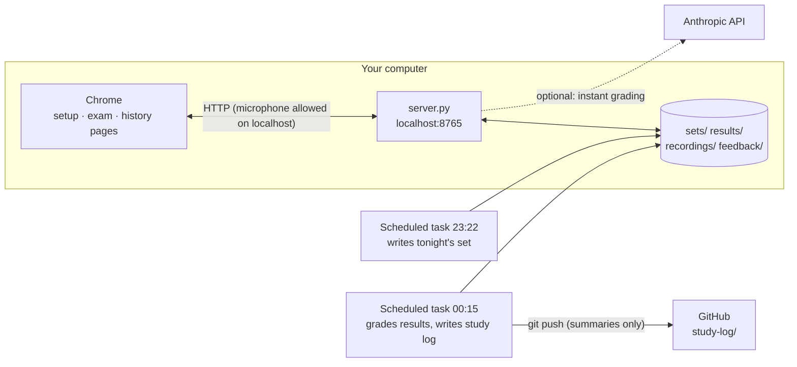

# OPIc Mock Test

A local, self-hosted OPIc speaking practice environment that behaves like the real
exam screen — avatar, play button, five-second replay, automatic recording, a
volume meter, the question grid, the orange **Next** button — plus a fresh
question set every night, AI feedback aimed at the **Advanced Low (AL)** level,
and a study log that fills your GitHub contribution graph.

It was built for one learner stuck at IH who wanted daily, realistic practice
instead of reading scripts. Everything runs on your own computer; your voice
recordings and transcripts never leave it.

---

## What a session looks like

1. **Setup page** (`/`) — tonight's set, number of questions, interviewer voice,
   microphone test with a live level bar, *Sample Question*.
2. **Exam page** (`/exam.html`) — one question at a time, exactly like the real
   test:
   - press ▶ to hear the question (text-to-speech, the most natural voice your
     OS offers is picked automatically);
   - recording starts when the question ends; the meter moves while you speak and
     a status line says *“recording · I can hear you”*;
   - within 5 seconds you may replay the question **once**;
   - after 2 minutes a notice tells you to wrap up and move on;
   - in a full 15-question test the difficulty re-selection screen appears after Q7,
     and the 40-minute limit applies.
3. **End of the exam** — every answer is saved (audio + live transcript) and
   graded. You get an estimated level, a fluency score, the two things blocking AL
   in each answer, corrected sentences, an AL rewrite of *your own* answer, a
   re-answer mission, expressions to reuse, and five sentences worth memorizing.
4. **History page** (`/feedback.html`) — every past session with its level and
   feedback.

### Question modes

| Mode | Questions | Time limit | Use it for |
|---|---|---|---|
| **3 · random** (default) | one random block | 8 min | the nightly habit |
| 3 · Q14–15 advanced focus | 1 extra hard advanced question + tonight's Q14, Q15 | 8 min | the AL-deciding questions |
| 3 · a chosen block | Q2–4, Q5–7, Q8–10 or Q11–13 | 8 min | drilling one type |
| 5 | Q11–15 (roleplay + advanced) | 13 min | the second half of the exam |
| 15 · full test | Q1–15 | 40 min | the real thing |

---

## How it works



### Why a local server

Browsers only give a page the microphone on a secure origin. `http://localhost`
counts as one, so a tiny standard-library Python server is enough: no HTTPS
certificates, no cloud hosting, no account system, and your recordings stay on
disk. The pages are plain HTML/CSS/JS with no build step.

### The pieces

| Path | Role |
|---|---|
| `server.py` | Serves `web/`, stores recordings and results, returns tonight's set, grades with the API when a key is configured, queues grading otherwise. Python 3 standard library only. |
| `web/index.html` | Setup page (mode, voice, mic test). |
| `web/exam.html` + `web/app.js` | The exam screen and its state machine: play → 5 s replay window → record → next, timers, 2-minute notice, difficulty screen, save. |
| `web/feedback.html` + `web/feedback.js` | History list and the feedback renderer (also used at the end of the exam). |
| `sets/YYYY-MM-DD.json` | Tonight's 15 questions. `sets/example.json` shows the format; when no set exists the page builds one from a built-in bank. |
| `prompts/feedback.md` | The grading rubric (ACTFL AL description turned into concrete checks and a JSON output contract). Used by both grading paths. |
| `prompts/daily-set.md`, `prompts/nightly-grade.md` | What the two scheduled tasks do. |
| `scripts/study_log.py` | Turns a day's results + feedback into `study-log/YYYY/YYYY-MM-DD.md` (summary only). |
| `scripts/*.command` | macOS double-click launchers: start the server, turn autostart at login on/off. |

### Audio, speech and timing in the browser

- **Questions** are read with the Web Speech API (`speechSynthesis`). Voices are
  ranked so *Natural / Neural / Premium / Google* voices win; each sentence is a
  separate utterance so long prompts are not cut off and pauses land where a
  person would breathe. Voice and speed are remembered per browser.
- **Recording** uses `getUserMedia` + `MediaRecorder` (one `.webm` per question).
- **Level meter** is an `AnalyserNode` RMS reading smoothed with a fast attack
  and slow release, so it rises the moment you speak.
- **Live transcript** uses `SpeechRecognition` (Chrome) in continuous mode,
  restarted automatically if it stops mid-answer.
- **Answer time** starts when the question finishes playing (or when it is
  replayed), matching how candidates experience the real test.

### Question generation

Each night a scheduled Claude task reads the last week of sets and two weeks of
results, finds weak question types (short answers, replays, peeking at the
text, low grades), and writes a new 15-question set that follows the real exam
structure: self-introduction → three topic combos (description / habit /
past experience / comparison) → roleplay (ask → problem with alternatives →
related experience) → two advanced questions (change over time, issue and
opinion). It avoids repeating any topic from the previous three days. A bank of
32 hard Q14–15-style questions in `app.js` powers the *advanced focus* mode.

### Feedback: two ways to grade

| | Instant | Nightly (default) |
|---|---|---|
| Needs | an Anthropic API key in `config.json` | nothing extra |
| When | seconds after the exam | by the next morning |
| Cost | API usage | included in your Claude plan |
| How | `server.py` sends the result and `prompts/feedback.md` to the Messages API | a scheduled Claude task grades every queued result on your Mac |

The key, if you add one, lives in `config.json` next to the server and is only
used by the server; the browser never sees it. `config.json` is git-ignored.

### Contribution graph

After grading, the nightly task writes `study-log/YYYY/YYYY-MM-DD.md` — date,
mode, total speaking time, estimated level, next focus, sentences to memorize —
and commits it with your GitHub identity. One study day, one green square.
Transcripts, recordings and the detailed feedback are git-ignored and never pushed.

---

## Run it yourself

Requirements: macOS, Windows or Linux with **Python 3.9+** and **Chrome**
(speech recognition is Chrome-only; everything else works in any modern browser).

```bash
git clone https://github.com/leesk212/OPIC-mock-test.git
cd OPIC-mock-test
python3 server.py            # then open http://localhost:8765
```

On macOS you can double-click `scripts/start.command` instead. Allow the
microphone when Chrome asks.

Optional:

- **Avatar** — put an interviewer image at `web/ava.png` (a generic illustration
  is used otherwise; the official exam avatar is not redistributed here).
- **Instant feedback** — `cp config.example.json config.json` and fill in
  `anthropic_api_key` (and `model` if you want a different one).
- **Tonight's set** — drop a file shaped like `sets/example.json` at
  `sets/<today>.json`, or let a scheduled task write it.
- **Port** — `OPIC_PORT=9000 python3 server.py`.

### Result file format

```json
{
  "date": "2026-10-17", "part": "Q11-13", "count": 3, "totalSec": 286,
  "items": [
    { "n": 11, "type": "rp1", "topic": "약속", "question": "…",
      "sec": 74, "replay": false, "text_shown": false,
      "transcript": "…", "audio": "recordings/2026-10-17/Q11.webm" }
  ]
}
```

Question types: `intro`, `d` description, `h` habit, `p` past experience,
`c` comparison, `rp1`/`rp2`/`rp3` roleplay, `a1`/`a2` advanced.

---

## How it was built

This project came out of a single long conversation with Claude, iterating from
"ask me OPIc questions in chat" to a real exam simulator:

1. **Research** — the official ACTFL OPIc Examinee Handbook (test forms, the
   Advanced-level description), Korean test-taker reports of the screen flow
   (replay rule, difficulty re-selection after Q7, 40-minute limit) and AL
   candidates' public answer videos.
2. **First attempt: a claude.ai artifact.** It reproduced the screen, but
   artifacts run sandboxed without microphone access, so answers could not be
   recorded.
3. **Second attempt: the chat itself.** Voice mode is not available in tool-using
   sessions, so the interviewer could not speak.
4. **Final design: a local server.** `localhost` gets the microphone, the files
   stay on the learner's machine, and Claude's role shrinks to what it is good
   at — writing the nightly set, grading against the AL rubric, and keeping the
   study log — through scheduled tasks.
5. **Iterations from real use** — separate setup and exam pages, a 3-question
   default for daily habit, random blocks, a dedicated Q14–15 mode, a visible
   "I can hear you" indicator, a 2-minute notice, more natural TTS, and feedback
   that rewrites the learner's own answer instead of inventing one.

## Limits

- Speech recognition is a browser feature; accuracy varies with accent and noise,
  and the grader is told to judge the speaker, not the recognizer.
- Estimated levels are coaching signals, not official OPIc scores.
- The scheduled tasks need the computer awake and the Claude desktop app running.

## License

MIT for the code. OPIc and ACTFL are trademarks of their owners; this project is
an unofficial practice tool and is not affiliated with them.
